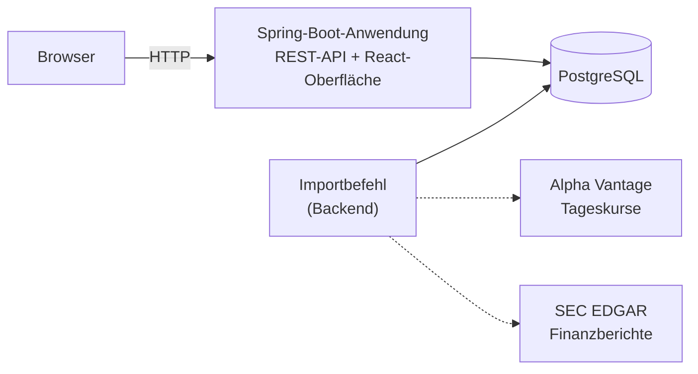

# 📊 RatioLab

### Fundamentalanalyse und Unternehmensvergleich

*Finanzdaten verstehen. Unternehmen vergleichen.*

---

**RatioLab** ist eine Webanwendung zur fundamentalen Analyse und zum Vergleich börsennotierter US-Unternehmen. Sie führt tägliche Aktienkurse und offizielle Finanzberichte zusammen, berechnet ausgewählte Kennzahlen nachvollziehbar und zeigt zu jedem Wert, woher er stammt und für welchen Zeitraum er gilt.

RatioLab entsteht im Rahmen einer Bachelorarbeit im Studiengang Informatik (B.Sc.) an der Heinrich-Heine-Universität Düsseldorf:

> **Entwicklung und Evaluation einer webbasierten Anwendung zur fundamentalen Aktienanalyse**

> [!IMPORTANT]
> **Die Implementierung steht am Anfang.** Anforderungen, Architektur und die Spezifikation der Daten und Kennzahlen sind ausgearbeitet. Im Repository existiert bisher nur das **Projektgerüst** (Spring-Boot-Backend und React-Frontend ohne fachliche Funktionen). Alle beschriebenen Funktionen sind **geplant**, nicht umgesetzt.

## Inhalt

- [Über das Projekt](#über-das-projekt)
- [Projektstatus](#projektstatus)
- [Geplanter Funktionsumfang](#geplanter-funktionsumfang)
- [Architektur](#architektur)
- [Technologien](#technologien)
- [Datenquellen](#datenquellen)
- [Datenqualität und Nachvollziehbarkeit](#datenqualität-und-nachvollziehbarkeit)
- [Qualitätssicherung und Evaluation](#qualitätssicherung-und-evaluation)
- [Reproduzierbarkeit](#reproduzierbarkeit)
- [Roadmap](#roadmap)
- [Abgrenzung](#abgrenzung)

---

## Über das Projekt

Die Fundamentalanalyse verbindet historische Aktienkurse mit veröffentlichten Finanzberichten und daraus abgeleiteten Kennzahlen. Diese Daten stammen aus verschiedenen Quellen mit unterschiedlichen Strukturen, Veröffentlichungszeitpunkten, Berichtszeiträumen und Nutzungsbedingungen. Fehlende Werte, nachträgliche Korrekturen und voneinander abweichende Geschäftsjahre erschweren transparente Vergleiche.

RatioLab soll zeigen, wie sich eine solche Anwendung so strukturieren lässt, dass **Korrektheit, Herkunft und Grenzen der Daten** sichtbar, testbar und wartbar bleiben. Die Bachelorarbeit untersucht dazu, welche Architektur- und Entwurfsansätze sich für eine solche Anwendung eignen und inwieweit die gewählte Architektur die definierten Anforderungen in der Praxis erfüllt.

Der Schwerpunkt liegt auf Softwarearchitektur, zuverlässiger Datenverarbeitung, systematischem Testen und einer reproduzierbaren Evaluation – nicht auf Anlageempfehlungen, Kursprognosen oder Handelsstrategien.

---

## Projektstatus

| Bereich | Status |
|---|---|
| Thema und Projektausrichtung | ✅ abgestimmt |
| Anforderungen, Architektur, Daten- und Kennzahlenspezifikation | ✅ ausgearbeitet |
| Praktische Prüfung der Datenquellen | ⏳ als Nächstes |
| Projektgerüst (Backend, Frontend) | ✅ angelegt |
| Fachliche Funktionen, Datenbank | ⬜ noch nicht begonnen |
| Datenimport | ⬜ noch nicht begonnen |
| Automatisierte Tests | ⬜ noch nicht begonnen |
| Evaluation | ⬜ noch nicht begonnen |

---

## Geplanter Funktionsumfang

| | Funktion | Beschreibung |
|---|---|---|
| 🏢 | **Unternehmensauswahl und Suche** | Auswahl und Suche innerhalb einer konfigurierten Liste realer US-Unternehmen, zunächst Apple und Microsoft |
| 📉 | **Kursverlauf** | Diagramm der verfügbaren täglichen, *nicht bereinigten* Schlusskurse mit Quelle und Datenstand |
| 📑 | **Jahresfinanzdaten** | Umsatz und Jahresüberschuss je Geschäftsjahr mit Berichtszeitraum, Einheit, Einreichungsdatum und Quelle; Ergebnis je Aktie (EPS), sofern zuverlässig abbildbar |
| 📊 | **Finanzhistorie** | Diagramm von Umsatz und Jahresüberschuss über mehrere Geschäftsjahre |
| 🧮 | **Kennzahlen** | Im Backend berechnete Nettomarge und Umsatzwachstum gegenüber dem Vorjahr, mit festgelegten Formeln |
| ⚖️ | **Unternehmensvergleich** | Gegenüberstellung zweier Unternehmen für dieselbe Kennzahl über vergleichbare Geschäftsjahre |
| ⚠️ | **Transparente Datenlücken** | Fehlende, veraltete oder nicht vergleichbare Werte erscheinen als „N/A“ mit Begründung – nie als erfundener Wert oder als Null |
| 🔄 | **Datenimport** | Kurse und Finanzdaten werden über einen Importbefehl im Backend geladen und in der Datenbank gespeichert |

---

## Architektur

RatioLab ist als **modularer Monolith** geplant: eine Spring-Boot-Anwendung mit klar getrennten Modulen, die die REST-API bereitstellt und im Betrieb auch die gebaute React-Oberfläche ausliefert, sowie eine PostgreSQL-Datenbank. Während der Entwicklung laufen der Vite-Entwicklungsserver und Spring Boot getrennt.

**Zentrale Entwurfsentscheidungen**

- **Lesen nur aus der Datenbank:** Alle Anfragen der Oberfläche werden aus PostgreSQL beantwortet. Das normale Arbeiten mit der Anwendung löst keine Anfragen an externe Anbieter aus.
- **Getrennter Datenimport:** Externe Datenquellen werden ausschließlich über einen Importbefehl im Backend abgefragt. Ausfälle oder Ratenlimits der Anbieter beeinträchtigen so nicht die Anzeige bereits gespeicherter Daten.
- **Kennzahlen im Backend:** Finanzkennzahlen werden als reine, deterministische Funktionen mit exakter Dezimalarithmetik (`BigDecimal`) berechnet; die Oberfläche stellt nur dar.
- **Gekapselte Datenquellen:** Jede Quelle besitzt einen eigenen Adapter für Abruf, Zeitlimits, Validierung und Normalisierung.
- **Bewusst einfach:** keine Microservices, keine Message-Broker, keine zusätzliche Cache-Infrastruktur.

---

## Technologien

| Bereich | Technologie | Status |
|---|---|---|
| Frontend | React, TypeScript, Vite | festgelegt |
| Diagramme | Apache ECharts | festgelegt |
| Backend | Java 25, Spring Boot 4.1.2 | festgelegt |
| Build-Werkzeug (Backend) | Gradle (Gradle Wrapper) | festgelegt |
| Schnittstelle | REST / JSON | festgelegt |
| Datenbank | PostgreSQL | festgelegt |
| Datenquellen | Alpha Vantage, SEC EDGAR | festgelegt |
| Datenbankmigrationen | versionierte Migrationen, z. B. Flyway | vorgesehen |
| Bereitstellung | containerisierte Einrichtung, z. B. Docker Compose | vorgesehen |
| Tests | JUnit 5, Vitest, React Testing Library | festgelegt |

*festgelegt* = entschieden · *vorgesehen* = geplant, die endgültige Auswahl erfolgt mit der Implementierung.
Quellcode und Code-Kommentare werden auf Englisch verfasst.

---

## Datenquellen

RatioLab verwendet ausschließlich **reale Unternehmen und echte Finanzdaten**.

| | Alpha Vantage | SEC EDGAR |
|---|---|---|
| **Liefert** | tägliche Aktienkurse (OHLCV) | offizielle Finanzberichte als XBRL-Daten (z. B. aus 10-K-Berichten) |
| **Verwendet für** | Kursdiagramm | Umsatz, Jahresüberschuss, EPS, Unternehmensstammdaten |
| **Nicht verwendet für** | Echtzeitkurse, bereinigte Kurse, Kennzahlen | Aktienkurse |
| **Zugang** | API-Schlüssel erforderlich | ohne Schlüssel, deklarierter `User-Agent` erforderlich |

**Bekannte Einschränkungen** – laut Dokumentation der Anbieter; sie werden vor der Implementierung praktisch überprüft:

- Der kostenlose Alpha-Vantage-Zugang erlaubt nur wenige Anfragen pro Tag und liefert nur die jüngsten rund 100 Handelstage. Vollständige Historie und split-/dividendenbereinigte Kurse sind kostenpflichtig; Kurse werden daher als *nicht bereinigt* gekennzeichnet.
- SEC EDGAR ist **kein** Kursdatenanbieter, begrenzt die Anfragerate und ist nur serverseitig abrufbar.
- Geschäftsjahre unterscheiden sich zwischen Unternehmen und entsprechen nicht immer Kalenderjahren; frühere Werte können in späteren Berichten korrigiert werden.
- Ob Rohdaten der Anbieter im Repository veröffentlicht werden dürfen, hängt von deren Nutzungsbedingungen ab und wird vorab geprüft.

---

## Datenqualität und Nachvollziehbarkeit

- **Herkunftsnachweis:** Jeder Wert trägt Quelle, Berichtszeitraum, Einheit und Importzeitpunkt, Finanzdaten zusätzlich Formular und Einreichungsdatum.
- **Kein Anschein von Echtzeit:** Die Oberfläche zeigt immer, wann Daten importiert wurden; gespeicherte Daten werden nicht als aktuelle Marktdaten dargestellt.
- **Keine erfundenen Werte:** Fehlende oder ungültige Eingaben ergeben „N/A“ mit einem definierten Grund, niemals eine Null.
- **Saubere Zeiträume:** Das Geschäftsjahr wird aus den Periodendaten abgeleitet; korrigierte Werte späterer Berichte werden nach einer festgelegten Regel ausgewählt, frühere Fassungen bleiben gespeichert.
- **Exakte Arithmetik:** Dezimalarithmetik mit festgelegter Rundung; Ergebnisse werden gegen unabhängig berechnete Referenzwerte geprüft.

---

## Qualitätssicherung und Evaluation

Die Evaluation orientiert sich an ausgewählten Qualitätsmerkmalen der ISO/IEC 25010 und prüft die Anwendung gegen vorab definierte Anforderungen:

| Dimension | Geplantes Vorgehen |
|---|---|
| **Funktionale Korrektheit** | Anforderungsbasierte Tests und ein dokumentierter Durchlauf der Kernfunktionen mit echten Daten |
| **Korrektheit der Kennzahlen** | Unit-Tests gegen unabhängig berechnete Referenzwerte inklusive Grenzfällen; Abgleich ausgewählter Werte mit den Original-10-K-Berichten |
| **Performance** | Wiederholte Messungen der Antwortzeiten unter dokumentierten Bedingungen |
| **Fehlerbehandlung und Robustheit** | Gezielt simulierte Fehler der Datenquellen, z. B. Ratenlimit, Zeitüberschreitung, fehlerhafte Antworten, wiederholte Importe |
| **Reproduzierbarkeit** | Einrichtung und Tests aus einem frischen Klon des Repositorys |

Testebenen: Unit-, Integrations- (gegen PostgreSQL), API- und Frontend-Tests. Tests rufen keine echten Anbieter auf, sondern verwenden gespeicherte Antworten.

---

## Reproduzierbarkeit

Ziel ist, dass die fertige Anwendung aus einem frischen Klon dieses Repositorys mit einer verständlichen Anleitung eingerichtet werden kann:

- Das Datenbankschema entsteht automatisch über versionierte Migrationen.
- Wiederholte Datenimporte erzeugen keine doppelten oder überschriebenen Datensätze.
- Zugangsdaten werden ausschließlich über Umgebungsvariablen gesetzt und gelangen weder ins Repository noch in die Oberfläche oder in Logs.
- Für reproduzierbare Tests und Auswertungen werden gespeicherte Momentaufnahmen echter Anbieterdaten verwendet, soweit die Nutzungsbedingungen dies erlauben.

Konkrete Anleitungen zu Einrichtung, Konfiguration, Datenimport, Tests und Fehlerbehebung folgen, sobald die Implementierung sie tatsächlich ermöglicht.

---

## Roadmap

Geplanter Ablauf, Stand November 2026. Die schriftliche Ausarbeitung erfolgt parallel.

| Zeitraum | Meilenstein |
|---|---|
| bis Mitte November 2026 | Projektaufbau und erster durchgängiger Prototyp (Browser → React → Spring Boot) mit echten Kursdaten |
| bis Ende November 2026 | Datenquellen praktisch geprüft; Importe für SEC EDGAR und Alpha Vantage mit Herkunftsnachweis |
| bis kurz vor Weihnachten 2026 | Kennzahlen, Oberfläche und Unternehmensvergleich – **Feature-Freeze** |
| bis Anfang Januar 2027 | Robustheitstests, Performance-Messungen, Evaluation, Reproduzierbarkeitsprüfung |
| Ende Januar 2027 | Abgabe der Bachelorarbeit |

---

## Abgrenzung

RatioLab ist als **lokaler Prototyp für eine einzelne Person** geplant. Nicht vorgesehen sind:

- Echtzeit- oder Intraday-Kurse
- Handel und Orderausführung
- Anlageempfehlungen und Kursprognosen
- Benutzerkonten und Portfolioverwaltung
- weltweite Marktabdeckung
- öffentliches Cloud-Hosting

> [!CAUTION]
> Dieses Projekt dient ausschließlich akademischen Zwecken und stellt **keine Anlageberatung** dar.

---

<b>RatioLab</b> · Fundamentalanalyse und Unternehmensvergleich Bachelorarbeit · Informatik (B.Sc.) · Heinrich-Heine-Universität Düsseldorf · Stand: November 2026

